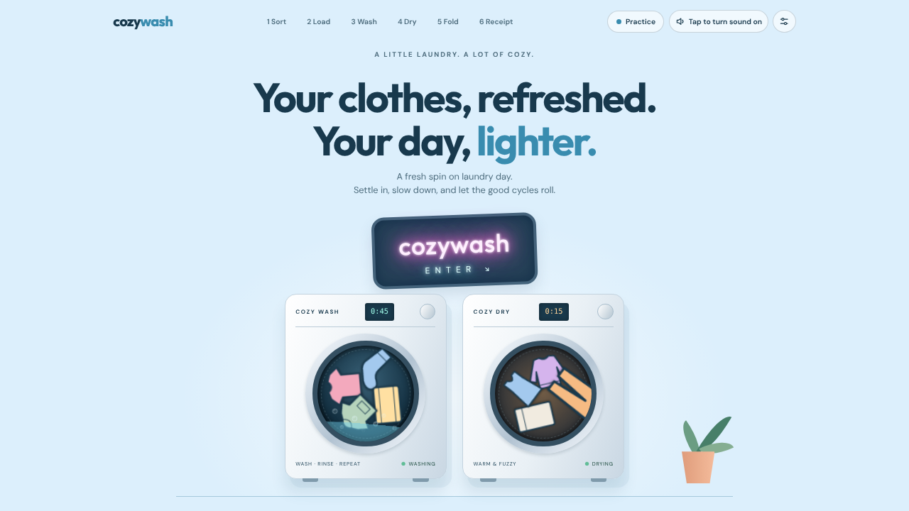
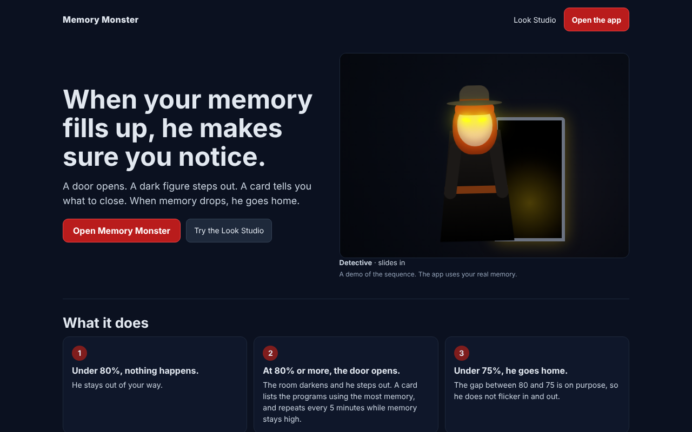

# MsHacktoberfest

Two projects, built in the open for Hacktoberfest 2026. Each one lives in its own folder with its own README, its own license, and its own way to run and check it.

| Project | What it is | Folder |
| --- | --- | --- |
| **Cozy Wash** | A cozy laundry game you play once a day | [`cozy-wash/`](cozy-wash/) |
| **Memory Monster** | A door opens and a dark figure steps out when your computer's memory gets too full | [`memory-monster/`](memory-monster/) |

---

## Cozy Wash



Sort the laundry, dose the washer, wash, dry, and fold each piece into the basket. One new basket a day, and the same date always gives the same basket. Watch out for the red sock in the whites, the phone in a pocket and the cat napping in the pile.

- Live at [cozywash.app](https://cozywash.app)
- [Gameplay video](cozy-wash-gameplay.mp4)
- [Read the Cozy Wash README](cozy-wash/README.md) and its [contributing guide](cozy-wash/CONTRIBUTING.md)

**Run it:**

```bash
cd cozy-wash
npm install
npm run serve      # http://localhost:5173
npm run check      # checks every data file and says in plain words what to fix
npm test
```

**Good first changes.** Most of the game is data, so a lot of good changes are one new JSON file: a new named item, a color, pattern, fabric or garment, a season, a fold, house notes, CC0 sounds, or an accessibility fix. The guides are in [`cozy-wash/docs/`](cozy-wash/docs/).

---

## Memory Monster



Memory Monster watches how much memory your computer is using. At 80% or more the room darkens, a door opens, and a hooded figure steps out. A card lists the programs using the most memory and asks you to close them. When memory drops below 75%, he steps back through the door.

You can change how he looks. Faces (including a redhead and a green alien), outfits, doors and ways of arriving are all choices you can see as pictures in the Look Studio. Four finished looks ship with it: Green Visitor, Detective, Ghost and Night Shift.

- Not online yet. It is set up to deploy from its own folder (see [Putting a project online](#putting-a-project-online)).
- [Short video](memory-monster/public/memory-monster-short.mp4) (1 minute 50 seconds) and the [long walkthrough](memory-monster/docs/memory-monster-walkthrough.mp4) (4 minutes 25 seconds)
- [Read the Memory Monster README](memory-monster/README.md) and its [contributing guide](memory-monster/CONTRIBUTING.md)

**Run it:**

```bash
cd memory-monster
npm install
npm run dev          # http://localhost:3000
npm run check-skins  # names the exact field if a skin has a mistake
npm test
```

**Good first changes.**

- **A new skin.** One small `skin.json` file in `community-skins/`. Copy `skins/_template`, or press Copy as skin.json in the Look Studio. [How to make one](memory-monster/MAKE-YOUR-OWN-FIGURE.md).
- **A new face, outfit, door or entrance.** Add it to `lib/skinOptions.js` and give it a style rule in `app/globals.css`. The tests fail if a look has no style rule.
- **Docs and accessibility fixes.**
- A Mac or Linux version would be its own game, not a port, because those systems handle memory differently. Open an issue first so we can talk about the design.

---

## How to contribute

1. Pick a project and read its contributing guide.
2. Fork, make a branch, make your change.
3. Run that project's checks: `npm run check` and `npm test` for Cozy Wash, `npm run check-skins` and `npm test` for Memory Monster.
4. Open a pull request. Keep it to one change, and say how you tested it.

By contributing you agree your work is shared under the license of the project you changed.

## Putting a project online

A repo can be imported into Vercel more than once, so each folder can be its own site. Choose **Add New Project**, pick this repo, then under **Root Directory** press **Edit** and choose the project's folder (for example `memory-monster`). Give it its own name and deploy. The Memory Monster README has the full steps for deploying it from a folder.

## Licenses and credits

- **Cozy Wash:** MIT. See [`cozy-wash/LICENSE`](cozy-wash/LICENSE).
- **Memory Monster:** idea and design by Cheryl. IP owned 100% by XYZ Agents LLC. MIT. See [`memory-monster/LICENSE`](memory-monster/LICENSE).
