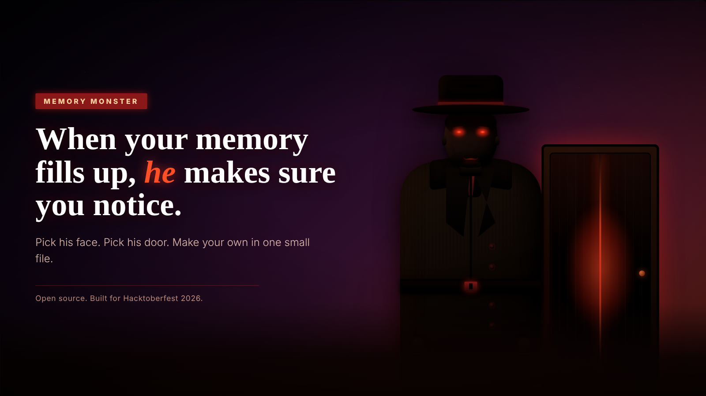

# Memory Monster

*A door opens and a dark figure steps out when your computer's memory gets too full.*

Idea and design by Cheryl. Owned 100% by XYZ Agents LLC. Open source under the license in `LICENSE`.

## Start here

Pick how you want to use it. You do not need to understand the code for any of these.

### A. The Windows desktop app (the real thing)

He appears over your whole screen, on top of your other programs, and the mouse goes straight through to your work. It reads your memory itself, so there is nothing else to set up.

1. Install **Node.js** (the LTS version) from https://nodejs.org if you do not have it.
2. Get this folder onto your computer: on GitHub press **Code, Download ZIP**, then unzip it. (Or `git clone` it.)
3. Open the `memory-monster` folder, then the `desktop` folder, and double-click **`run-memory-monster.bat`**. The first run installs what it needs and builds the site, which takes a few minutes. Later runs start in seconds.
4. Look for his small icon in the system tray, bottom-right near the clock (click the little arrow if it is hidden). Right-click it and choose **Test the figure** to see him straight away.

Nothing appears on screen until memory crosses the line (80% by default). The full guide, with the tray menu, the installer and what to do if something goes wrong, is in [`desktop/README.md`](desktop/README.md).

### B. Try the website on your computer

1. Install **Node.js** as above, and open a terminal in this `memory-monster` folder.
2. Run `npm install` (once), then `npm run dev`.
3. Open http://localhost:3000. Press **Open the app**, then **Test the figure**. Drag the slider to see him arrive.

This is also how you work on the code. `npm test` runs the tests and `npm run check-skins` checks the skins.

### C. Put the website on Vercel

See [Put it on Vercel](#put-it-on-vercel) below. There are no environment variables to set.

## The pages

| Address | What it is |
| --- | --- |
| `/` | The landing page: a looping demo, how it works, everything you can change as pictures, the finished looks, and the short video |
| `/app` | Memory Monster itself |
| `/looks` | The Look Studio |
| `/overlay` | The page the desktop app draws over your screen. It only works inside the desktop app. |

The landing page shows the short video only when `public/memory-monster-short.mp4` is in the project. Without it, the video section is left out.

## What it does

Memory Monster watches how much memory is in use.

1. **Under 80%:** nothing happens.
2. **At 80% or more:** the room darkens, the door opens, and a dark figure steps out.
3. **While it stays high:** a card in the top-left corner lists the programs using the most memory and asks you to close them. It repeats every 5 minutes.
4. **Under 75%:** he steps back through the door, the door closes, and the room brightens.

The gap between 80 and 75 is on purpose. Without it he would pop in and out every time your memory hovers around one number.

## How the website gets your memory

A website can't see how full your computer is, so the page gets its number from one of three places. You pick in Settings:

| Source | What it reads | Good for |
| --- | --- | --- |
| Demo slider | A slider on the page | Seeing the door and figure without filling anything |
| This browser tab only | The tab's own memory use (Chrome and Edge only) | A quick look. It does **not** measure your computer. |
| The helper | Real memory use for the whole computer, and the biggest programs | The real thing, in the browser |

The helper is a small program that runs on your own computer. See [`helper/README.md`](helper/README.md). It listens only on `127.0.0.1`, so nothing outside your computer can reach it, and it needs a code that only your browser knows. **The desktop app does not need the helper.**

A website also can't draw over your desktop. Open the page in its own window, press **Full screen**, or press **Pop out** for a small always-on-top window (Chrome and Edge), and leave it where you can see it. You can also turn on a notification in Settings, so a hidden tab still tells you when he arrives. For the real thing, over your whole screen, use the desktop app.

## Put it on Vercel

The website is plain static files: no server code, no database, no accounts.

1. Put this folder in a GitHub repo.
2. In Vercel, choose **Add New Project**, pick the repo, and deploy. The defaults work: Vercel detects Next.js on its own.
3. Open the address Vercel gives you. That is the landing page; press **Open the app** to use Memory Monster.

That is the whole deploy. There are no environment variables to set.

### If this folder lives inside a bigger repo

A repo can be imported into Vercel more than once, so another project in the same repo keeps running untouched. Do the same steps, with these changes:

1. After you pick the repo, find **Root Directory**, press **Edit**, and choose the `memory-monster` folder. Give the project its own name.
2. In the new project's settings, add an **Ignored Build Step** so it skips builds when nothing in `memory-monster/` changed. Without it, every push to the repo rebuilds every project connected to it.
3. To deploy before a branch is merged, set the project's **Production Branch** to that branch.

This folder imports nothing from outside itself, so the Root Directory setting is all it needs.

## Try it without filling your memory

Press **Test the figure**. It plays the whole sequence once with a pretend 85% and a short list of sample programs (labelled as samples on the card), then lets him leave.

## The buttons

| Button | What it does |
| --- | --- |
| Test the figure | Plays the sequence once. |
| Snooze 15 min | Sends him away and holds him back for 15 minutes. |
| Turn off (8 h) | Stops watching. It turns itself back on after 8 hours so you don't forget it is off. |
| Full screen | Fills the screen with the scene. |
| Pop out | Opens a small always-on-top window with the scene (Chrome and Edge only). |
| Look Studio | Pick his face, outfit, door and eyes from thumbnails. |
| Settings | Source, figure, notifications, and the numbers below. |

Snooze and Turn off work at any time, even while he is on screen.

## The alert card

With the helper connected, each program on the card has a **Close it** button. Memory Monster **always asks you to confirm** before closing anything, and it asks the program politely, so a program with unsaved work can still ask you to save. Anything unsaved can still be lost, so save first. Without the helper the card can't see your programs and says so.

## Settings

The defaults live in `settings.json`. Change one, deploy again, and everyone gets the new default. You can also change them for yourself in the Settings panel; those choices stay in your browser only. A value that is missing or doesn't make sense is ignored and the default is used.

| Setting | Default | What it means |
| --- | --- | --- |
| `enterPercent` | 80 | He arrives at this memory percent or higher. |
| `leavePercent` | 75 | He leaves once memory drops below this. Keep it lower than `enterPercent`. |
| `reminderMinutes` | 5 | How often the reminder repeats while memory stays high. |
| `snoozeMinutes` | 15 | How long Snooze lasts. |
| `autoOnHours` | 8 | How long Turn off lasts before it turns itself back on. |
| `pollSeconds` | 3 | How often the website asks the helper for a new reading. |
| `skin` | `shadow-form` | Which figure and door to use. |

## Change how he looks

Press **Look Studio** to choose from pictures: seven faces (including a redhead, a green alien and a face in shadow), six outfits (hood, cloak, trench coat, top hat, hoodie, shadow trench coat), five doors (including one ajar with a crack of light) and four ways to arrive. Every choice is a thumbnail of the real figure, so you see it before you pick it, and **Copy as skin.json** saves a look you like as a skin.

Shadow Form is the default look, and five more ship with it so you can see what a custom look is: `hooded-figure`, `green-visitor`, `detective`, `ghost` and `night-shift`. Pick one in Settings.

The figure, the door and what he says all live in a skin folder, so you can also change them by editing a file, without touching the app code. See `MAKE-YOUR-OWN-FIGURE.md`.

## Privacy

- The site has no accounts, no analytics and no server of its own.
- The desktop app makes no network calls at all, except to its own page on `127.0.0.1` inside the app.
- Your settings, source choice and helper code are saved in your browser only.
- The memory reading and program names go from the helper on your computer to the page in your browser. They are not sent anywhere else.

## Why it is Windows-first

Windows gives a clear "percent of memory in use" reading, and the 80 and 75 rules are built on it. The desktop app and the helper are written for that. Their memory reading runs on any system with Node, but macOS keeps memory filled on purpose, so a high percent is normal there and the rules would need to be different. A Mac or Linux version would be its own game, not a port. CONTRIBUTING.md says how to start one.

## Videos

- `public/memory-monster-short.mp4` (1 minute 49 seconds) is the short video on the landing page: a real system monitor beside Memory Monster as memory fills up, then four custom entrances.
- `docs/memory-monster-walkthrough.mp4` (4 minutes 27 seconds) is the long version, including editing a skin in a terminal, checking it, building it and seeing it.

## Credits and ownership

Memory Monster is Cheryl's idea and design. This is IP owned 100% by XYZ Agents LLC. Anything derived from this project names XYZ Agents LLC as its owner.

## License

MIT, with the copyright held by XYZ Agents LLC. See `LICENSE`.
